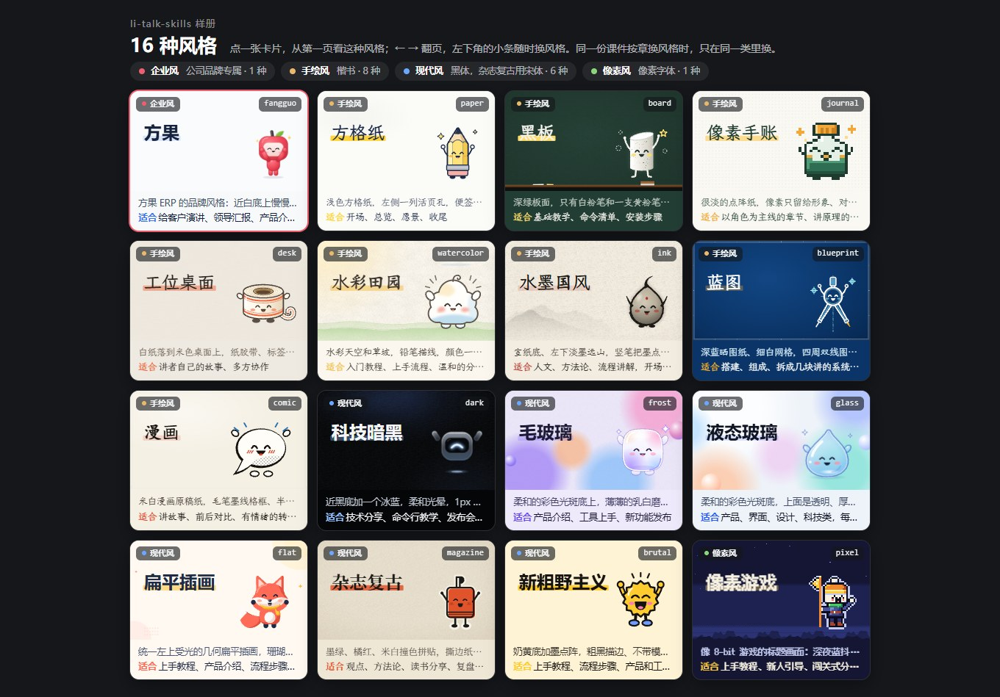
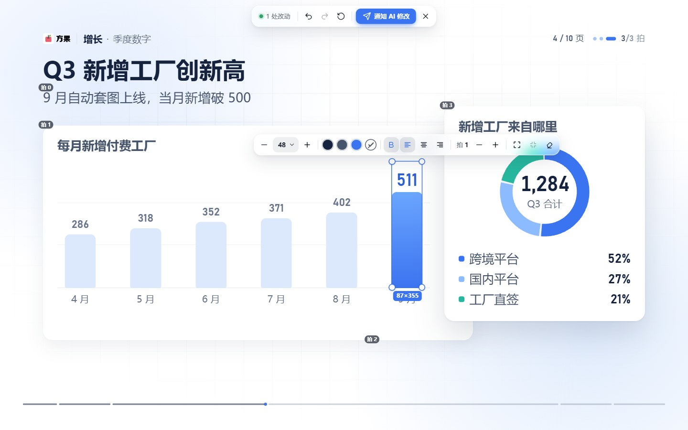
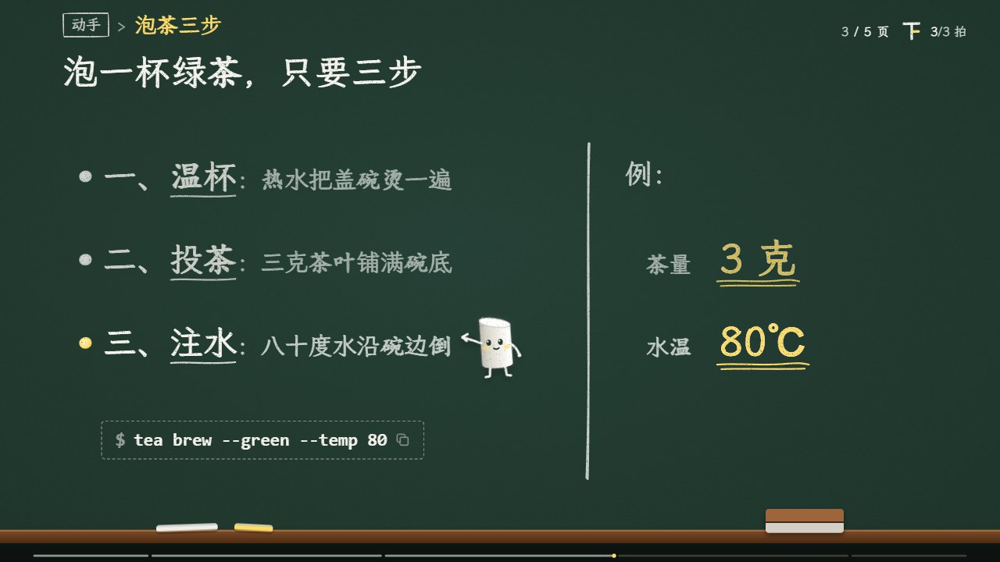
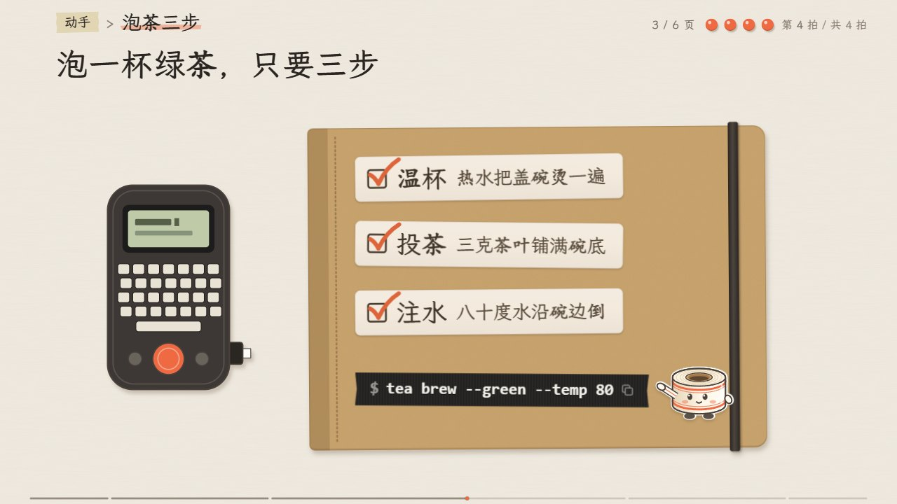
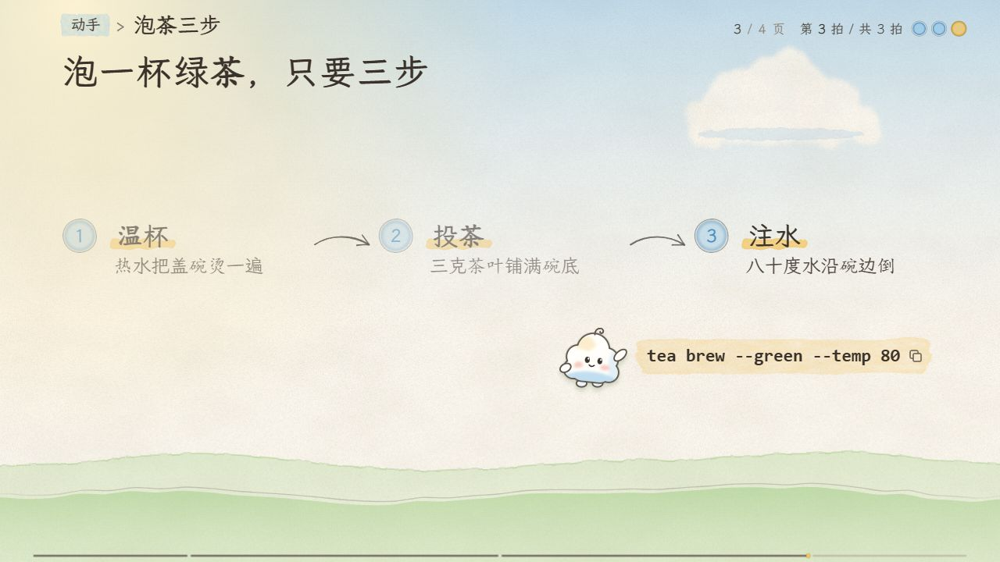

<div align="center">

# li-talk-skills

**AI talk-deck skill with live editing · 16 styles · one sentence to start**

Hand your topic, notes or script to the AI and get an HTML deck you can present right away: it steps through beat by beat, opens offline with a double-click, and comes with a presenter view, rehearsal timer and a mascot for every style. Want to change something? Edit it in the browser, then hand the changes back to the AI to merge into the source.

[](https://xiaoli1999.github.io/li-talk-skills/)
[](LICENSE)
[](CHANGELOG.md)
[](#16-styles)
[](#16-styles)
[](#edit-in-the-browser)
[](#how-quality-is-checked)
[](#faq)

[](#install)
[](#install)
[](#install)
[](#install)
[](#install)

**[🌐 Website](https://xiaoli1999.github.io/li-talk-skills/)** · **[📖 Tutorial](https://xiaoli1999.github.io/li-talk-skills/tour/)** · **[🎨 All styles](https://xiaoli1999.github.io/li-talk-skills/gallery.html)** · **[📝 Changelog](CHANGELOG.md)** · [中文](README.md) | English

</div>



<sub>The gallery home page: 16 styles in four groups (hand-drawn, modern, pixel, corporate) on one screen, each with its own mascot. Click a card to step through that style's sample slides.</sub>

## Highlights

- **One sentence to start**: a bare topic, scattered notes and screenshots, or a finished script all work. The AI follows a nine-step flow (script, style, layout, animation) and stops at five checkpoints (outline, script, style, first 3 slides, final review) for your OK.
- **Live editing**: double-click to change text, drag and scale blocks, change font size, colour and beat, undo and redo, all in the browser. Click "Notify AI" and the AI writes the changes back into the source with class names and chapter CSS, re-runs the self-check, and the page reloads.
- **16 styles, 16 mascots**: four families (hand-drawn, modern, pixel, corporate). Not just colour swaps: each style has its own layouts, components, beat animations, and a mascot that walks around and talks.
- **Ready to present**: content appears beat by beat and fades once covered; the presenter view shows notes, the next beat, a timer and rehearsal mode; blackout, laser pointer and slide overview; clickers just work.
- **Self-check at 5 screen sizes**: a real browser steps through every slide and beat from 1920×1080 down to a phone in portrait, checking overflow, overlap, contrast and font size, and writes a report that even models without vision can act on.
- **Offline, zero dependencies**: plain HTML; double-click `index.html` to present, no network, nothing to install. Phones switch to a vertical reading mode automatically.
- **Works with many agents**: Claude Code, Codex, Cursor, and Chinese tools such as DeepSeek and WorkBuddy; anything that can run commands and read and write local files.



<sub>Live editing: font size and colour only appear when you select text, and changing one block doesn't move the others; the top bar shows the change count, undo and redo, reset all, and "Notify AI".</sub>

**Good for**: tech talks, training sessions, reports, presentations and client proposals, when you want web slides you click through beat by beat, with a presenter view for your notes.

**Not for**: exporting to pptx or pdf, plain documents, or data dashboards.

## Install

**Easiest**: just ask the AI

> Install xiaoli1999/li-talk-skills from GitHub globally, then open the tutorial and walk me through it

No setup needed on your side: the skill needs Node 18 or later, and if it isn't installed the AI will install it for you first.

**Command line** (Claude Code, Node 18+ already installed):

```bash
npx skills add xiaoli1999/li-talk-skills -g -a claude-code -y
```

For Codex, replace `claude-code` with `codex`; for Cursor, with `cursor`.

Install globally only, not into a project. Start a new conversation afterwards so the skill gets loaded.

**Tutorial**: you can also read it online first: [https://xiaoli1999.github.io/li-talk-skills/tour/](https://xiaoli1999.github.io/li-talk-skills/tour/) (in Chinese). The first time you use it, the AI asks whether you want a few-minute tutorial. If you do, it opens a short deck about how the tool works in your browser, then the gallery to show you every style. You can skip it and come back any time by asking the AI to "open the li-talk-skills tutorial".

## Use

In any folder, tell the AI:

> Use li-talk-skills to make a deck about "…"

The AI first asks what you already have, and starts from one of three places:

| You have | What the AI does |
|---|---|
| Just a topic | Asks one question at a time: who the audience is, how long, where and on what screen, what they should take away; then drafts an outline for you to edit |
| Ideas, notes, screenshots | You put them in the deck's `素材/` (materials) folder or tell the AI where they are; it lists them, turns them into an outline, and only asks about what's missing |
| A finished script | Reformats it into the standard layout, fills the gaps, and asks you to confirm |

Then it works step by step and **stops at five points for your OK**:

1. **Outline**: the parts, and how many slides each.
2. **Script**: on-screen text, beats, and the notes you'll read from.
3. **Style**: the AI recommends one and opens the gallery so you can see them all. You decide.
4. **First 3 slides**: the cover plus two typical slides, shown to you after the self-check passes. The rest is written only after you're happy.
5. **Review**: the whole deck, revised based on your feedback.

You can switch conversations or models halfway: progress lives in files in the deck folder, and the AI checks them before every step.

## 16 styles

Four families. A deck can switch styles by chapter, but only within one family. Each style has a default mascot, and you can swap in another style's mascot.

A style is more than a color scheme: its layouts, structure and what happens on each beat all follow its own look. Graph Paper corrects in red pen, Blueprint draws an assembly list, Comic tells it in four panels, Pixel Game walks a level map. Each style turns the same topic into 5–6 sample slides, and the AI writes your deck after the samples of the style you pick. The images below show one signature slide per style.

### Hand-drawn (Kai script)

| Look | Style | Default mascot | Good for |
|---|---|---|---|
|  | **Grid Paper** `paper` | Jianjian: a worn-down yellow pencil stub | Openings, overviews, vision, closings |
|  | **Chalkboard** `board` | Shasha: a stub of white chalk | Basics, command lists, install steps |
|  | **Pixel Journal** `journal` | Diandian: a pixel ink bottle | Character-driven chapters, how-it-works diagrams |
|  | **Desk** `desk` | Juanjuan: a roll of washi tape | Personal stories, teamwork across groups |
|  | **Watercolor Meadow** `watercolor` | Duoduo: a little watercolor cloud | Beginner tutorials, onboarding, gentle talks, non-technical audiences |
|  | **Ink Wash** `ink` | Mowan: a drop of ink with a cinnabar dot | Humanities, methodology, walkthroughs, ceremonial openings and closings |
|  | **Blueprint** `blueprint` | Quanquan: a drafting compass | Building things, components, systems broken into parts |
|  | **Comic** `comic` | Daodao: a brush-inked speech bubble | Storytelling, before/after, emotional turns, light-hearted twists |

### Modern (sans-serif; Retro Magazine uses serif)

| Look | Style | Default mascot | Good for |
|---|---|---|---|
|  | **Tech Dark** `dark` | Weiguang: a floating cube robot | Tech talks, command-line teaching, launches, product intros |
|  | **Frosted Glass** `frost` | Xiaowu: a frosted-glass jelly | Product intros, getting started with tools, feature launches |
|  | **Liquid Glass** `glass` | Toutou: a clear glass droplet | Product, UI, design and tech topics with little text per slide |
|  | **Flat Illustration** `flat` | Xiaoye: a geometric fox in a yellow scarf | Tutorials, product intros, step-by-step flows, newcomers |
|  | **Retro Magazine** `magazine` | Xiaoqian: an orange-red type block | Opinions, methodology, book talks, retrospectives |
|  | **Neo-Brutalism** `brutal` | Pengpeng: a yellow burst-sticker monster | Tutorials, step-by-step flows, product and tool intros, internal talks |

### Pixel (Chinese pixel font)

| Look | Style | Default mascot | Good for |
|---|---|---|---|
|  | **Pixel Game** `pixel` | Xiaoqi: a pixel guide carrying a pennant | Tutorials, onboarding, level-by-level steps, casual team talks |

### Corporate (company brand)

| Look | Style | Default mascot | Good for |
|---|---|---|---|
|  | **Fangguo** `fangguo` | Fang Xiaoguo: the company IP, a little fruit with a rounded square head | Client pitches, reports to management, product intros, business numbers |

## Presenting

| Key | Action |
|---|---|
| → ↓ Space PageDown Enter, or click | Next beat (moves to the next slide when this one is done) |
| ← ↑ PageUp Backspace | Previous beat |
| Home / End | First / last slide |
| S | Open the presenter view (separate window: notes for each beat, current beat highlighted, next beat preview, timer) |
| T / R | Start or pause the timer / reset it |
| H | Start or end rehearsal, in the presenter view |
| O | Overview: thumbnails of every slide; click one or type its number and Enter to jump; Esc or O again to close |
| B or . | Black screen (many clickers send "." from their blank-screen button); B, Esc, a navigation key or a click brings it back without advancing |
| L | Laser pointer on/off: the cursor becomes a red dot with a short trail; clicks still advance |
| F | Fullscreen |

- Navigation keys, O, B and L pressed in the presenter window control the main window too.
- **Rehearsal**: press H in the presenter view before the real talk. It records time per slide, estimates a suggested time from the length of your notes, and turns overtime slides red. Press H again for a summary you can copy to the AI so it trims the notes of slides that ran long.
- **Progress bar**: a thin line along the bottom, moving with the beats and split by chapter. Nothing to set up.
- **Phones and tablets in portrait** switch to reading mode: slides stack vertically with all beats shown. Add `?read` to the URL to force it, `?notes=1` to show the notes.
- Swipe left and right on touch screens; reloading keeps your place.

## Edit in the browser

Once the first draft is done and you want to tweak it yourself, tell the AI "I want to edit it in the browser". It starts an editing service that only listens on your machine, and the page opens in edit mode:

- Double-click to change text; click to select, then drag to move, arrow keys to nudge, Delete to hide.
- Drag a corner to scale the whole block (text and images together, images keep their ratio; hold Shift to scale from the top-left corner); hold Alt while dragging to resize the box.
- A small toolbar floats next to the selection: font size (32–120 px or the style's size steps), colour (the style's palette), bold, alignment, which beat the block appears on, and reset this block. Font size and colour only show up when you select text; while editing text you can also mark the selected words as key words. Alt+↑ selects the enclosing block.
- Ctrl+Z to undo, Ctrl+Y to redo, many steps deep; "Reset all" at the top clears every change not merged yet.
- Changed text or notes are merged as-is first, then the AI offers a few wording suggestions and only applies the ones you pick.
- Press S for the presenter view and click a beat's notes to edit them.
- Everything saves automatically. Click "Notify AI" at the top: the AI merges the changes into the source, re-runs the self-check, and the page reloads on the same slide so you can keep going. Edits you make while the AI is merging are kept for the next round.
- A deck opened by double-click (no service) can still enter edit mode with E; click "Copy changes for AI" and paste the text into the chat.

## How quality is checked

The AI writes each slide by hand, and the hard part is knowing whether it looks right. So after each batch it runs two checks:

- **A check without a browser**: takes seconds and catches authoring mistakes, things outside the technical limits (such as loading network resources), and notes that don't match the beats.
- **A headless browser self-check**: opens the deck in your local Edge or Chrome in the background and measures every beat of every slide at five sizes (1920×1080, 1440×900, 1280×720, 1024×768, and 390×844 portrait reading mode) for overflow, overlap, text covered by the mascot, text that's too small, leftovers after stepping back, errors and so on. The report says which slide and beat, which size, the measured numbers and how to fix it, so weaker models that can't see images can fix issues by following it.
- **Readability**: however rich a style's layout is, every slide must be complete and readable from the back row at its last beat. The self-check warns about three things: text with less than 3:1 contrast against its background (faded, already-covered beats included), vertical text that runs too long, and text from an earlier beat that is no longer visible at the last beat.

The AI only shows you the deck once every error is cleared.

## Updates

- Once installed, the first li-talk-skills command each day checks for a new release. Only changed files are downloaded, and everything is replaced at once only after all files verify; a failed update doesn't affect what you're doing. The AI passes on the highlights; they take effect in a new conversation.
- To see the version or update right away, ask the AI to "check the li-talk-skills version" or "update li-talk-skills" (the `version` and `update` commands).
- Updates only replace the skill itself. **Decks you've already made are never touched.**

## FAQ

**Do fonts need the internet?**

The hand-drawn family uses LXGW WenKai. The full font (about 8.8 MB) is downloaded the first time it's needed and kept in `~/.li-talk-skills/fonts/`. If the download fails, nothing blocks: a bundled small font with common characters is used, rare characters fall back to the system Kai font, and you can switch to the full font later. The pixel font for Pixel Game ships with the skill; the modern family uses system fonts.

**Does it work offline? How do I share a deck?**

Yes. A deck is a folder; double-click `index.html` to open it, with no network and no external resources. To share, copy the whole folder or zip it, and the other person double-clicks `index.html`. Decks currently include the full font files (about 10 MB); a pack command that keeps only the characters you use isn't done yet.

**Can I get an online link?**

Depends on your AI tool. When the deck is done, if the tool can host web pages (e.g. WorkBuddy, Codex), the AI asks whether to publish it; it only uploads if you say yes, then gives you the link. The whole deck is uploaded, screenshots included, so think twice about internal material. After edits, publish again to update the link. If the tool can't host pages, it won't ask; you can still share the folder.

**Which browsers?**

Everything works in Chrome and Edge. Safari and Firefox display decks fine with a few effects degraded, e.g. Liquid Glass refraction becomes a light blur. The self-check needs Edge or Chrome installed locally.

**The presenter view disconnected?**

When the deck is opened from disk (`file://`), reloading the main window disconnects the presenter window, and its bottom turns red. Go back to the main window and press S again.

**Can screenshots leak information?**

Clicking a screenshot in a deck shows the original image. Even if the slide only shows part of it, the rest of the image can be seen, so remove sensitive information before adding it.

**Can it export pptx or pdf?**

No. This skill only makes HTML decks.

## Not yet

A screen pen, a shortcut help panel, line-by-line code highlighting, a before/after slider, video, charts, more slide templates, packing a deck for sharing, and upgrading existing decks are not built yet. See [docs/roadmap.md](docs/roadmap.md) (in Chinese).

## License and attribution

Licensed under the [Apache License 2.0](LICENSE): free to use, modify and use commercially. **If you redistribute, fork or build on this project, keep the attribution in [NOTICE](NOTICE)** (based on li-talk-skills by xiaoli1999) and mark the files you changed.

Third-party components keep their own licenses, which sit next to them in `skills/li-talk-skills/template/vendor/`:

- [GSAP](https://gsap.com): animation, GreenSock Standard License
- [rough.js](https://roughjs.com): hand-drawn lines, MIT
- [LXGW WenKai](https://github.com/lxgw/LxgwWenKai): Kai script font for the hand-drawn family, SIL Open Font License 1.1
- [Fusion Pixel Font](https://github.com/TakWolf/fusion-pixel-font): Chinese pixel font for Pixel Game, SIL Open Font License 1.1
