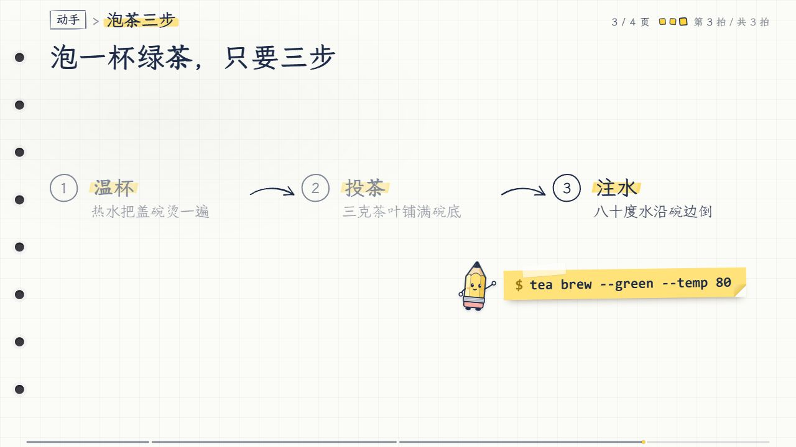
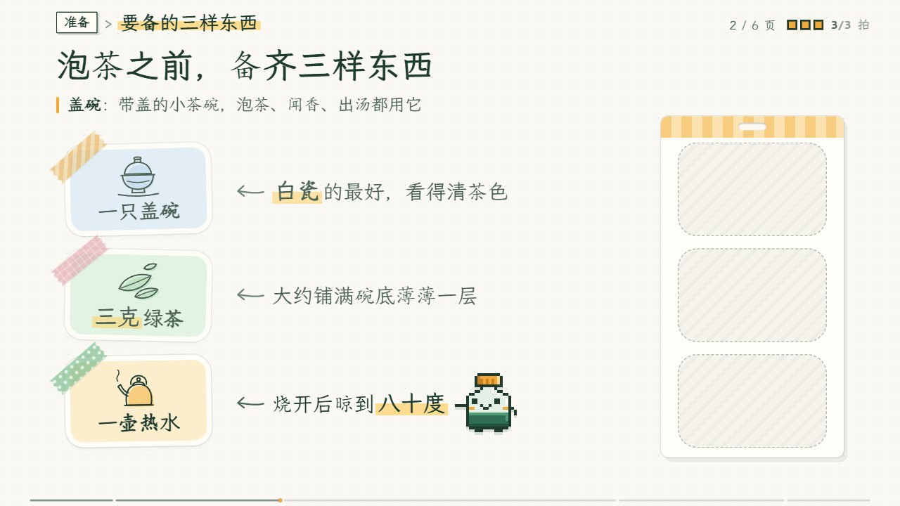
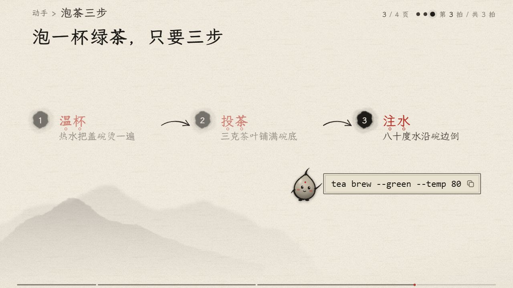
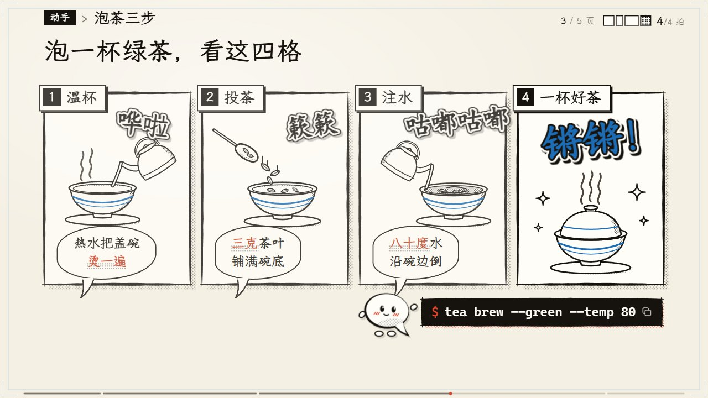
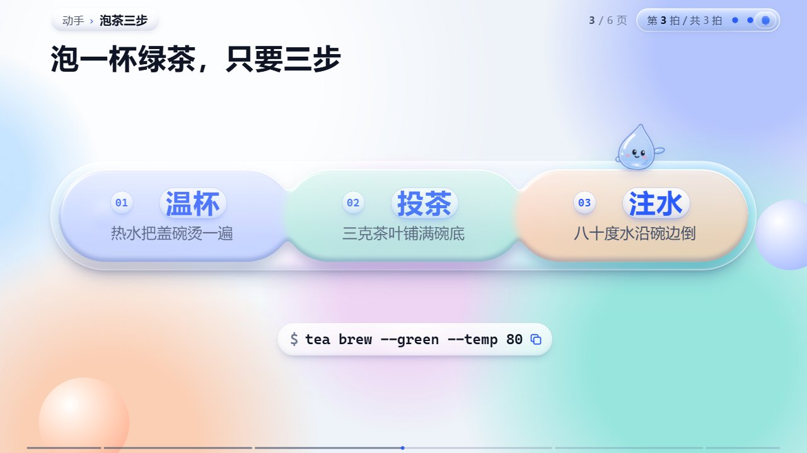
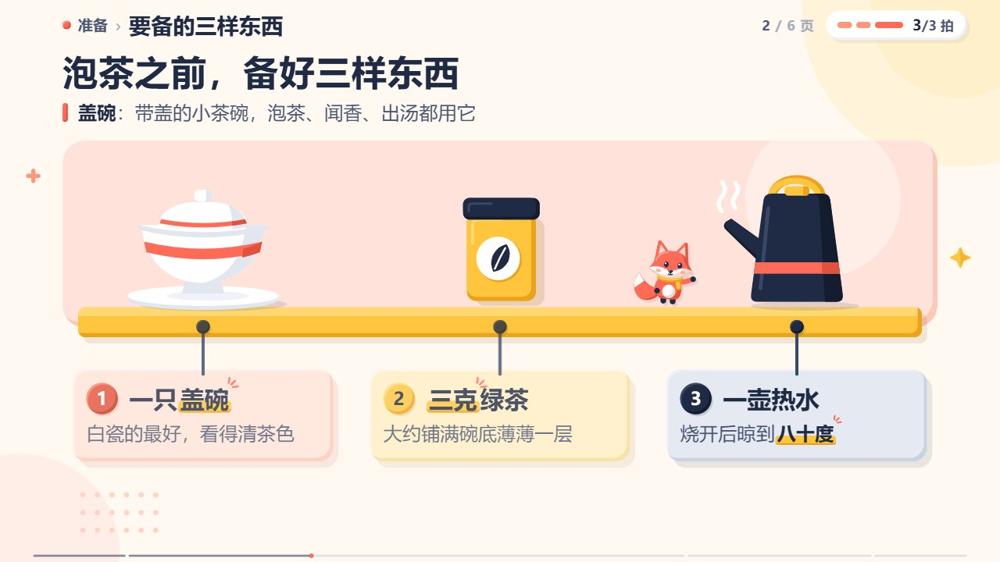
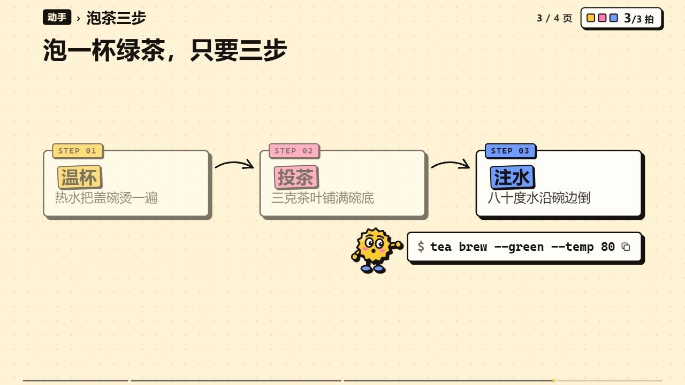
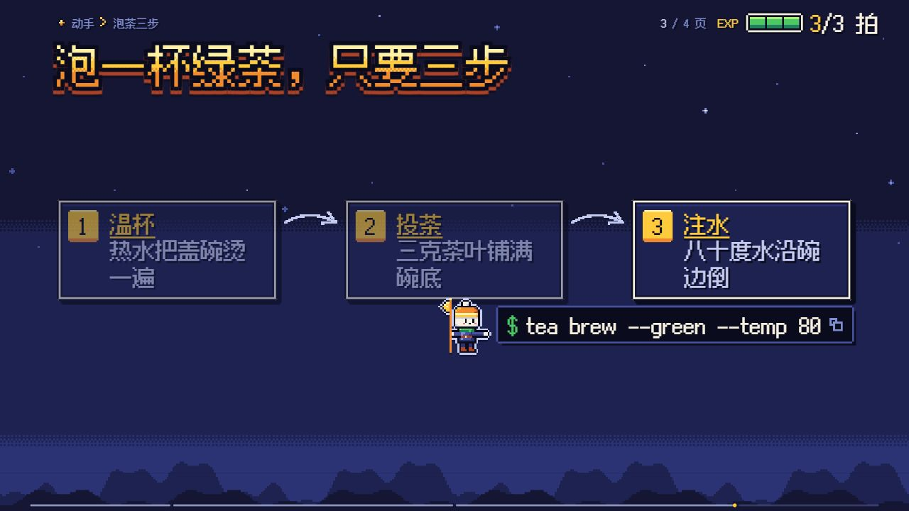
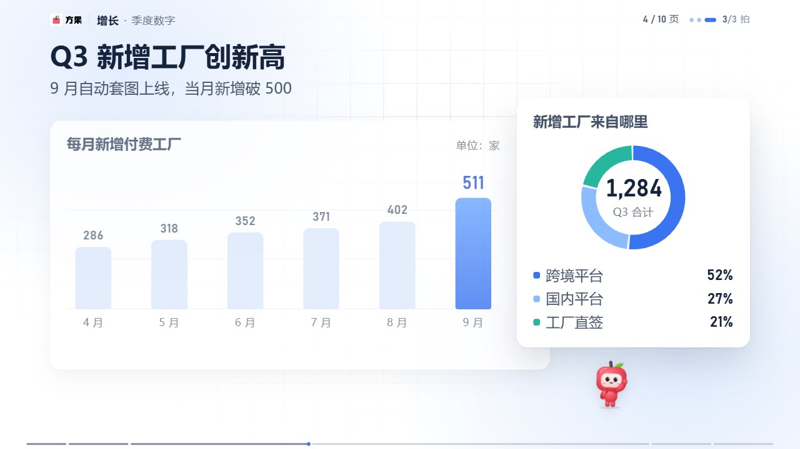

<div align="center">

# li-talk-skills

**AI talk-deck skill with live editing · 16 styles · one sentence to start**

Hand your topic, notes or script to the AI and get an HTML deck you can present right away: it steps through beat by beat, opens offline with a double-click, and comes with a presenter view, rehearsal timer and a mascot for every style. Want to change something? Edit it in the browser, then hand it back to the AI to merge into the source.

[](https://xiaoli1999.github.io/li-talk-skills/)
[](LICENSE)
[](CHANGELOG.md)
[](#16-styles)
[](#16-styles)
[](#live-editing)
[](#features)
[](#features)

[](#quick-start)
[](#quick-start)
[](#quick-start)
[](#quick-start)
[](#quick-start)

**[🌐 Website](https://xiaoli1999.github.io/li-talk-skills/)** · **[📖 Tutorial](https://xiaoli1999.github.io/li-talk-skills/tour/)** · **[🎨 All styles](https://xiaoli1999.github.io/li-talk-skills/gallery.html)** · **[📝 Changelog](CHANGELOG.md)** · [中文](README.md) | English

</div>


## Features

| | Feature | What it does |
|---|---|---|
| 💬 | **One sentence to start** | A bare topic, scattered notes or a finished script all work; the AI writes the script, picks a style, lays it out and animates it, checking with you at key points |
| ✏️ | **Live editing** | Double-click to edit text, drag and scale blocks, change font size, colour and beats in the browser, then hand the changes to the AI in one click |
| 🎨 | **16 styles · 16 mascots** | Hand-drawn, modern, pixel and corporate families, each style with its own layouts, animations and a mascot that walks around |
| 🎤 | **Ready to present** | Content appears beat by beat; presenter view with notes and rehearsal timer; blackout, laser pointer, slide overview; clickers just work |
| 📱 | **Responsive on every screen** | Adapts from big screens and laptops to tablets and phones in portrait, self-checked slide by slide at 5 screen sizes before delivery |
| 📦 | **Offline · zero dependencies** | Plain HTML: double-click `index.html` to present, no network, nothing to install; share the folder as is |
| 🤖 | **Works with many agents** | Claude Code, Codex, Cursor, DeepSeek, WorkBuddy and more: anything that can run commands and read and write local files |

**Good for** tech talks, training, reports, presentations, client pitches · **Not for** pptx / pdf export, plain documents, dashboards

## Quick start

### The lazy way

Send this to your AI agent and let it do the rest (it installs Node first if needed):

```text
Install xiaoli1999/li-talk-skills from GitHub globally, then open the tutorial and walk me through it
```

### Command line

```bash
npx skills add xiaoli1999/li-talk-skills -g -a claude-code -y
```

For Codex use `codex`, for Cursor use `cursor`. Needs Node 18+; start a new conversation after installing.

### Your first deck

```text
Use li-talk-skills to make a deck about "…"
```

The AI starts from whatever you have (a topic, notes and screenshots, or a script) and stops at five checkpoints, **outline → script → style → first 3 slides → review**, for your OK. You can switch conversations or models halfway.

> New here? The [online tutorial](https://xiaoli1999.github.io/li-talk-skills/tour/) (in Chinese) covers install, the workflow, styles and presenting in five minutes.

## Live editing


Tell the AI "I want to edit it in the browser" and the page opens in edit mode:

- **Text**: double-click to edit and mark key words; font size and colour appear only when text is selected, and one change never moves the rest
- **Layout**: drag to move, drag a corner to scale, hold Alt to resize the box, Delete to hide; with a block selected, click a line of text inside it to move just that text
- **Pacing**: change which beat a block appears on; edit notes right in the presenter view
- **Undo anything**: Ctrl+Z / Ctrl+Y, or reset in one click
- **Hand it to the AI**: changes save automatically; click "Notify AI" and it writes them back into the source, re-runs the self-check, and the page reloads

## 16 styles

More than colour swaps: layouts, structure and what happens on each beat follow each style's own look. A deck can switch styles by chapter (within one family), and every style ships with a full set of sample slides.

### Hand-drawn (Kai script)

| Look | Style | Default mascot | Good for |
|---|---|---|---|
|  | **Grid Paper** `paper` | Jianjian: a worn-down yellow pencil stub | Openings, overviews, vision, closings |
|  | **Chalkboard** `board` | Shasha: a stub of white chalk | Basics, command lists, install steps |
|  | **Pixel Journal** `journal` | Diandian: a pixel ink bottle | Character-driven chapters, how-it-works diagrams |
|  | **Desk** `desk` | Juanjuan: a roll of washi tape | Personal stories, teamwork across groups |
|  | **Watercolor Meadow** `watercolor` | Duoduo: a little watercolor cloud | Beginner tutorials, onboarding, gentle talks, non-technical audiences |
|  | **Ink Wash** `ink` | Mowan: a drop of ink with a cinnabar dot | Humanities, methodology, walkthroughs, ceremonial openings and closings |
|  | **Blueprint** `blueprint` | Quanquan: a drafting compass | Building things, components, systems broken into parts |
|  | **Comic** `comic` | Daodao: a brush-inked speech bubble | Storytelling, before/after, emotional turns, light-hearted twists |

### Modern (sans-serif; Retro Magazine uses serif)

| Look | Style | Default mascot | Good for |
|---|---|---|---|
|  | **Tech Dark** `dark` | Weiguang: a floating cube robot | Tech talks, command-line teaching, launches, product intros |
|  | **Frosted Glass** `frost` | Xiaowu: a frosted-glass jelly | Product intros, getting started with tools, feature launches |
|  | **Liquid Glass** `glass` | Toutou: a clear glass droplet | Product, UI, design and tech topics with little text per slide |
|  | **Flat Illustration** `flat` | Xiaoye: a geometric fox in a yellow scarf | Tutorials, product intros, step-by-step flows, newcomers |
|  | **Retro Magazine** `magazine` | Xiaoqian: an orange-red type block | Opinions, methodology, book talks, retrospectives |
|  | **Neo-Brutalism** `brutal` | Pengpeng: a yellow burst-sticker monster | Tutorials, step-by-step flows, product and tool intros, internal talks |

### Pixel (Chinese pixel font)

| Look | Style | Default mascot | Good for |
|---|---|---|---|
|  | **Pixel Game** `pixel` | Xiaoqi: a pixel guide carrying a pennant | Tutorials, onboarding, level-by-level steps, casual team talks |

### Corporate (company brand)

| Look | Style | Default mascot | Good for |
|---|---|---|---|
|  | **Fangguo** `fangguo` | Fang Xiaoguo: the company IP, a little fruit with a rounded square head | Client pitches, reports to management, product intros, business numbers |

## Presenting

| Key | Action | Key | Action |
|---|---|---|---|
| → Space / click | Next beat | ← | Previous beat |
| S | Presenter view (notes, next beat, timer) | H | Rehearsal (overtime slides turn red) |
| O | Slide overview | B or . | Blackout |
| L | Laser pointer | F | Fullscreen |
| T / R | Start/pause / reset timer | E | Edit mode |

Phones and tablets in portrait switch to a reading mode; swipe to change slides. Clickers just work.

## Quality checks

After every batch the AI runs two checks: a quick pass over the code and beat counts, then a real browser that steps through every slide and beat at 5 screen sizes for overflow, overlap, font size and contrast, with a report. **Nothing reaches you until the errors are zero**, and even models without vision can fix issues from the report.

## Updates

It checks for a new version the first time you use it each day, downloads only changed files and replaces them after verification; the AI tells you what's new. Decks you've already made are never touched.

## FAQ

<details>
<summary><b>Does it work offline? How do I share a deck?</b></summary>

Yes. A deck is a folder; double-click `index.html` and it loads nothing from the network. Zip the folder and send it.
</details>

<details>
<summary><b>Can I publish it as a link?</b></summary>

In tools that can host web pages (WorkBuddy, Codex, etc.) the AI asks when the deck is done and only uploads if you agree. Screenshots inside become public too.
</details>

<details>
<summary><b>Do the fonts need the internet?</b></summary>

The hand-drawn Kai font downloads once on first use (about 8.8 MB, reused afterwards); if that fails, a bundled common-character subset is used.
</details>

<details>
<summary><b>Which browsers are supported?</b></summary>

Everything works in Chrome and Edge; Safari and Firefox display fine with a few effects degraded. The self-check needs Edge or Chrome installed.
</details>

<details>
<summary><b>Can it export pptx or pdf?</b></summary>

No, this skill focuses on HTML decks.
</details>

See [docs/roadmap.md](docs/roadmap.md) for what's planned.

## License and attribution

Licensed under the [Apache License 2.0](LICENSE): free to use, modify and use commercially. **If you redistribute, fork or build on this project, keep the attribution in [NOTICE](NOTICE)** (based on li-talk-skills by xiaoli1999) and mark the files you changed.

Third-party components keep their own licenses (see `skills/li-talk-skills/template/vendor/`): [GSAP](https://gsap.com) (GreenSock Standard License), [rough.js](https://roughjs.com) (MIT), [LXGW WenKai](https://github.com/lxgw/LxgwWenKai) (OFL 1.1), [Fusion Pixel Font](https://github.com/TakWolf/fusion-pixel-font) (OFL 1.1).

## Friends

- [skillhey.com](https://skillhey.com): a curated collection of AI skills, a good place to find more abilities for your AI agent
