# li-talk-skills · 演讲课件

中文 | [English](README.en.md)

一个给 AI 编程工具用的 skill：把你的主题、想法、截图或讲稿，交给 AI 做成一份 **HTML 演讲课件**。像幻灯片一样一拍一拍地翻，双击就能离线打开，带演讲者视图、计时、彩排和动效，每种风格还有自己的小形象。


<sub>样册里同一个虚构主题「怎么泡好一杯茶」，在 9 种风格下各自的招牌页，停在最后一拍：每种风格有自己的版式，讲过的要点都留在页上。</sub>

**适合**：要做技术分享、培训、汇报、演讲，想要一份网页版幻灯片，讲的时候一拍一拍地点、有演讲者视图看讲词的人。

**不适合**：要导出 pptx 或 pdf、要的是纯文档或数据看板。

能用在 Claude Code、Codex、Cursor 这类能跑命令、能读写本地文件的 AI 编程工具里；网页版聊天框用不了。

## 怎么装

需要 Node 18 及以上。

**命令行**（Claude Code）：

```bash
npx skills add xiaoli1999/li-talk-skills -g -a claude-code -y
```

用 Codex 就把 `claude-code` 换成 `codex`，用 Cursor 换成 `cursor`。

**不想敲命令**：直接对 AI 说

> 从 GitHub 仓库 xiaoli1999/li-talk-skills 安装到全局，装好后打开新手教程带我过一遍

只装到全局目录，不装进某个项目。装好后新开一个对话，新装的 skill 才会加载。

**新手教程**：第一次用时，AI 会先问你要不要花 3 分钟过一遍新手教程。选了的话，AI 会在浏览器里打开一份讲「这个工具怎么用」的课件，再打开样册带你看全部风格；不想看可以跳过，以后对 AI 说「打开 li-talk-skills 新手教程」随时能回来。

## 怎么用

在任意目录对 AI 说：

> 用 li-talk-skills 帮我做一个关于「……」的课件

AI 会先问你手上有什么，从三种起点出发：

| 你手上有 | AI 会怎么做 |
|---|---|
| 只有一个主题 | 一问一答：讲给谁、讲多久、在什么场合和屏幕上讲、最想让听众带走什么，然后起一份提纲给你改 |
| 有想法、笔记、截图 | 把材料放进课件目录的 `素材/`（或告诉 AI 在哪），AI 列出素材清单、整理成提纲，只问缺的部分 |
| 已经有讲稿 | AI 把它整理成标准格式，补上缺的段落，给你确认 |

之后 AI 一步步往下走，**在五处停下来等你确认**，你说了「可以」才继续：

1. **提纲**：分几部分、每部分几页。
2. **讲稿**：每页屏幕上的字、分几拍、照着讲的讲词。
3. **风格**：AI 按内容推荐，并打开样册让你看全部风格，你说了算。
4. **先做 3 页**：封面加两页最典型的内容，自检通过后打开给你看；满意了再写全稿。
5. **过稿**：整份课件给你看，按你的意见改。

中途换对话、换模型也能接着做：进度记在课件目录的文件里，AI 每一步都会先查一遍。

## 15 种风格

分三家。一份课件可以按章换风格，但只在同一家里换。每种风格有自己的默认形象，也可以换成别的风格的形象。

每种风格不只是换配色：版式、结构和每一拍发生的事都按它自己的样子来，比如方格纸用红笔订正，蓝图画装配清单，漫画画四格，像素游戏走关卡地图。每种风格都把同一个主题做成了 5–6 页样板，AI 写课件时照你选的那种写。下表里的图是每种风格的一页招牌页。

### 手绘家（楷书）

| 样子 | 风格 | 默认形象 | 适合讲什么 |
|---|---|---|---|
| 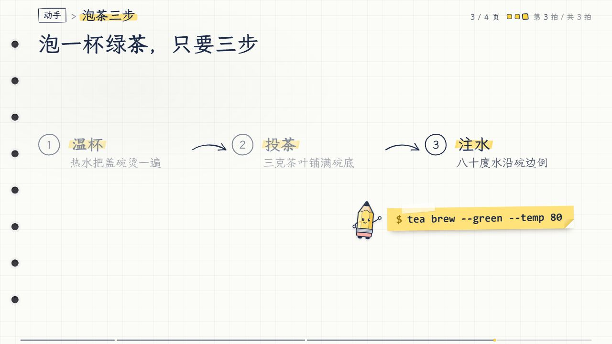 | **方格纸** `paper` | 尖尖：一截用短了的黄色铅笔头 | 开场、总览、愿景、收尾 |
| 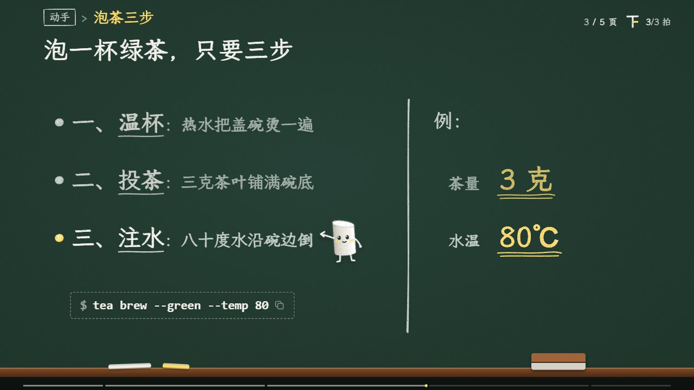 | **黑板** `board` | 沙沙：一截白粉笔头 | 基础教学、命令清单、安装步骤 |
| 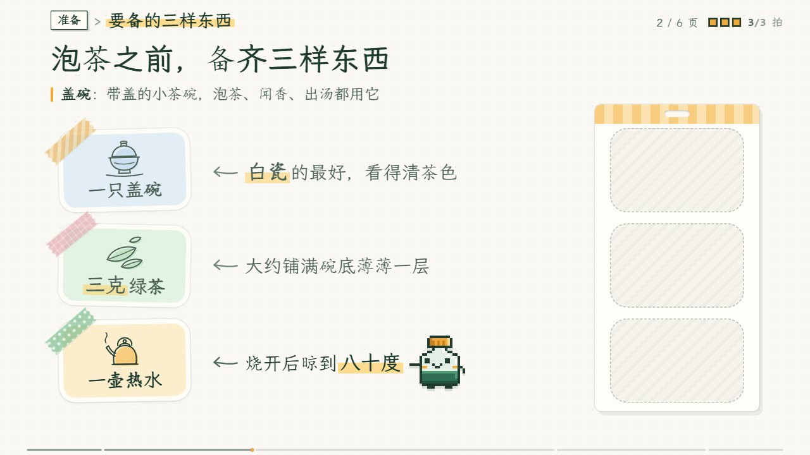 | **像素手账** `journal` | 点点：一只像素墨水瓶 | 以角色为主线的章节、讲原理的示意图 |
| 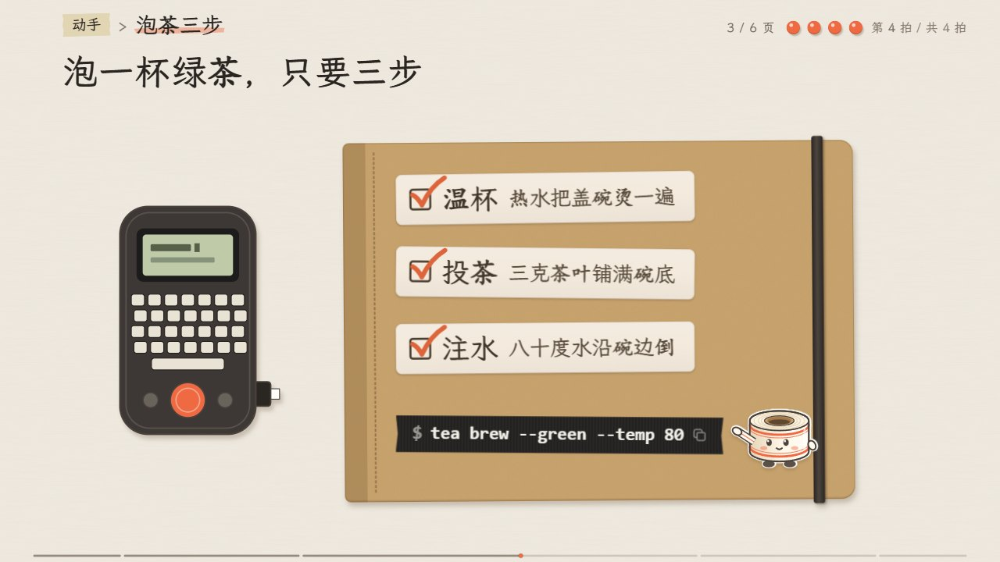 | **工位桌面** `desk` | 卷卷：一卷和纸胶带 | 讲者自己的故事、多方协作 |
| 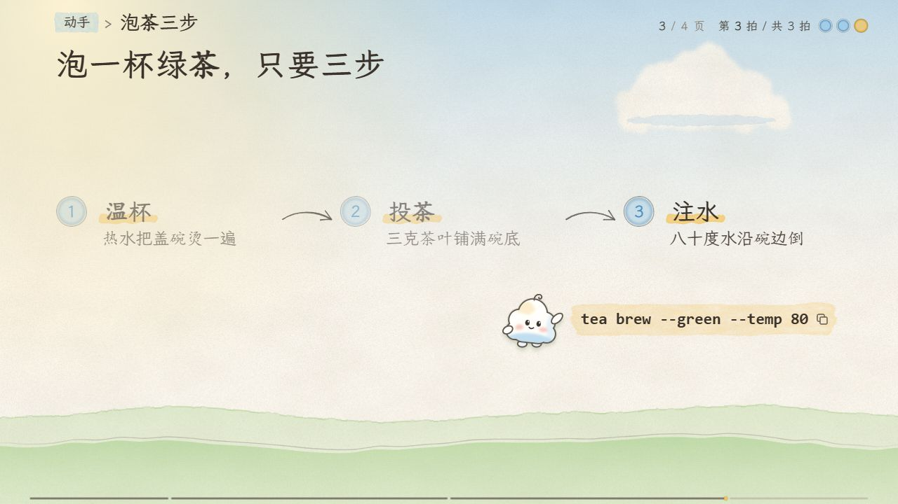 | **水彩田园** `watercolor` | 朵朵：一朵水彩小积云 | 入门教程、上手流程、温和的分享、面向非技术同事 |
| 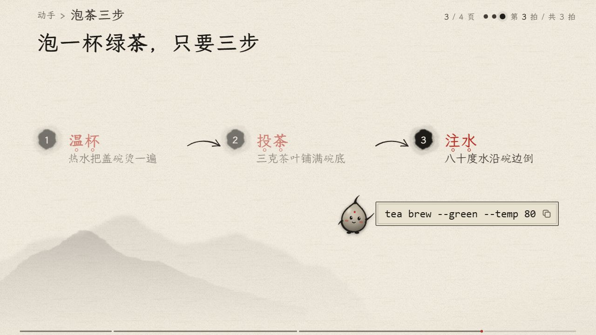 | **水墨国风** `ink` | 墨丸：一滴墨，眉心一粒朱砂 | 人文、方法论、流程讲解，开场和收尾要有仪式感的时候 |
| 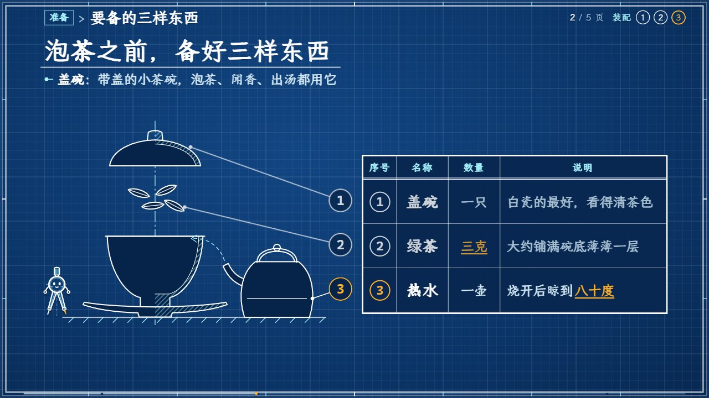 | **蓝图** `blueprint` | 圈圈：一只会画圈的制图圆规 | 搭建、组成、拆成几块讲的系统和结构 |
| 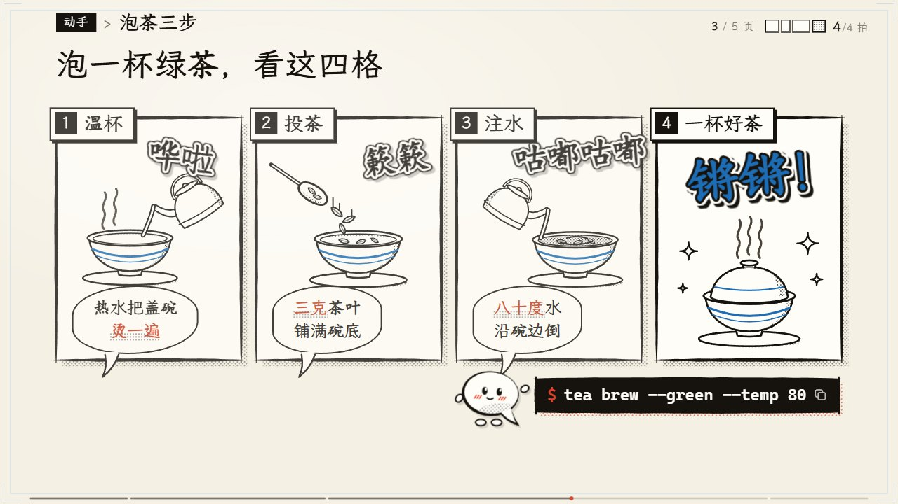 | **漫画** `comic` | 叨叨：一个毛笔墨线的对话框 | 讲故事、前后对比、有情绪的转折、轻松的吐槽和反转 |

### 现代家（黑体，杂志复古用宋体）

| 样子 | 风格 | 默认形象 | 适合讲什么 |
|---|---|---|---|
| 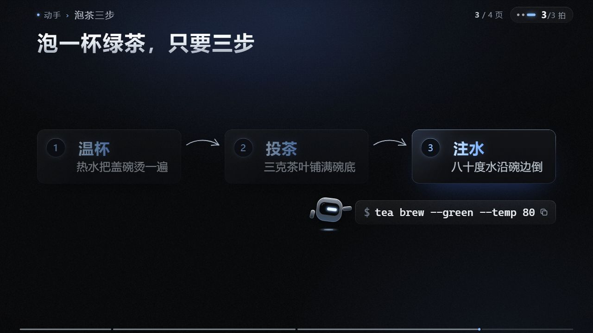 | **科技暗黑** `dark` | 微光：悬浮的小方块机器人 | 技术分享、命令行教学、发布会、产品介绍 |
| 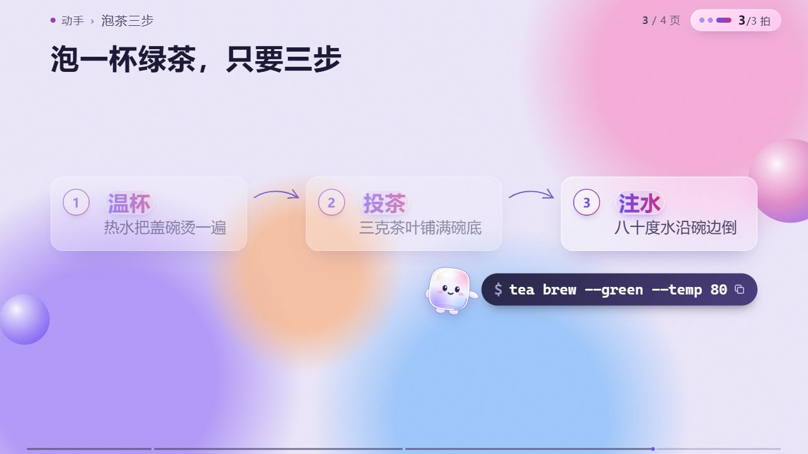 | **毛玻璃** `frost` | 小雾：一块磨砂玻璃小果冻 | 产品介绍、工具上手、新功能发布 |
|  | **液态玻璃** `glass` | 透透：一颗玻璃小液滴 | 产品、界面、设计、科技类，每页信息不多 |
|  | **扁平插画** `flat` | 小页：围着黄围巾的几何小狐狸 | 上手教程、产品介绍、流程步骤、新人或非技术听众 |
|  | **杂志复古** `magazine` | 小铅：一枚橘红铅字块 | 观点、方法论、读书分享、复盘总结 |
| 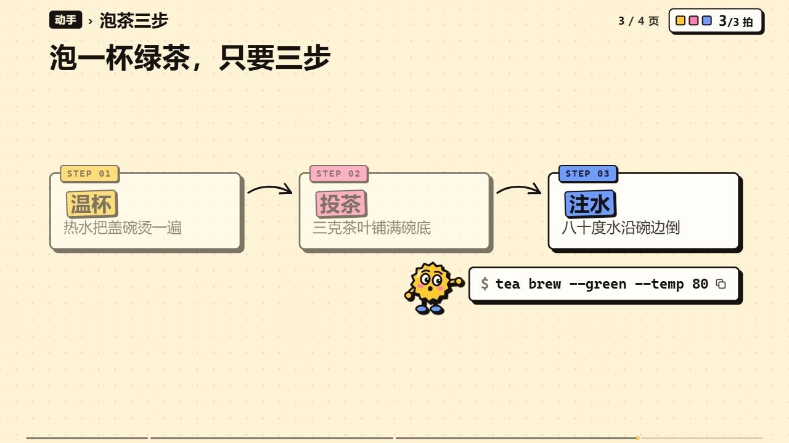 | **新粗野主义** `brutal` | 砰砰：黄色爆炸贴纸小怪物 | 上手教程、流程步骤、产品和工具介绍、内部分享 |

### 像素家（中文像素字体）

| 样子 | 风格 | 默认形象 | 适合讲什么 |
|---|---|---|---|
| 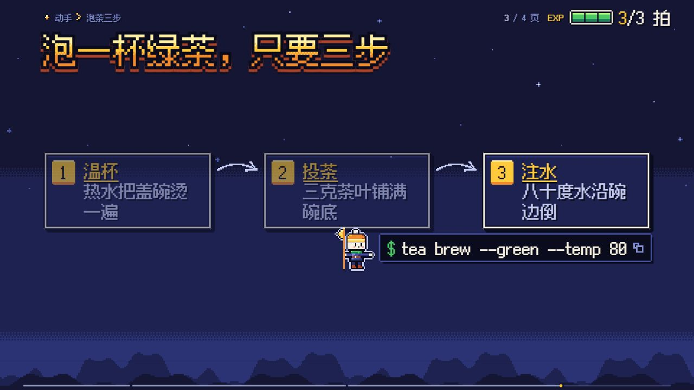 | **像素游戏** `pixel` | 小旗：背一面三角旗的像素小向导 | 上手教程、新人引导、闯关式分步、轻松的团队分享 |

## 讲的时候

| 键 | 作用 |
|---|---|
| → ↓ 空格 PageDown Enter，或点一下 | 下一拍（本页拍完进下一页） |
| ← ↑ PageUp Backspace | 上一拍 |
| Home / End | 第一页 / 最后一页 |
| S | 打开演讲者视图（另开窗口：本页每拍的讲词、当前拍高亮、预告下一拍、计时） |
| T / R | 计时开始或暂停 / 计时归零 |
| H | 在演讲者视图里开始或结束彩排 |
| O | 总览跳页：铺开所有页的缩略图，点一页或敲页码回车跳过去，Esc 或再按 O 关闭 |
| B 或 . | 黑屏（很多翻页笔的黑屏键发的就是「.」）；再按 B、Esc、翻页键或点一下恢复，不会顺手翻页 |
| L | 激光笔开关：鼠标变成带拖尾的红点，开着时点击照常进拍 |
| F | 全屏 |

- 在演讲者视图的窗口里按翻页键、O、B、L，同样控制主窗口。
- **彩排**：正式讲之前，在演讲者视图里按 H 开始，记下每页用时，按讲词字数估出建议用时，超时的页整条变红；再按 H 出小结，可以复制给 AI，让它删减超时页的讲词。
- **进度条**：舞台底边一条细线，按全稿拍数走、按章节分段，不用设置。
- **手机、平板竖屏**自动变成阅读模式：页面上下滑，所有拍直接展开。地址加 `?read` 可以强制进入，加 `?notes=1` 显示讲词。
- 平板和手机上左右滑动翻页；刷新页面不丢位置。

## 质量怎么保证

页面由 AI 手写，难的是写完不知道效果对不对。所以每写完一批，AI 都要跑两种检查：

- **不开浏览器的检查**：几秒查完写法错误、越界的技术用法（比如引用网络资源）、讲词拍数和页面对不上等。
- **后台浏览器自检**：用本机的 Edge 或 Chrome 在后台打开课件，按 1920×1080、1440×900、1280×720、1024×768 和手机竖屏 390×844 五个尺寸逐页逐拍量一遍：溢出、重叠、形象挡字、字号太小、退回后没收干净、报错等，出一份中文报告。每条写明在第几页第几拍、哪个尺寸、量到的数字和怎么改，看不了图的较弱模型照着报告改就行。
- **可读性**：风格的版式再丰富，翻到每页最后一拍时整页信息要完整、后排也读得清。自检会提醒三类问题：字和底色的对比度不到 3:1（讲过变淡的也算）、竖排太长、某一拍出现的字到最后一拍看不见了。

错误清零，AI 才把课件给你看。

## 更新

- 装好后，每天第一次运行 li-talk-skills 的命令时，会自动检查有没有新的正式版本；有就只下载变了的文件，全部校验通过才整个替换，失败了不影响这次使用。AI 会把这次的要点转告你，新开一个对话后生效。
- 想看版本或马上更新，对 AI 说「看看 li-talk-skills 的版本」或「更新 li-talk-skills」（对应 `version`、`update` 命令）。
- 更新只换 skill 本身，**已经做好的课件不会被改动**。

## 常见问题

**字体要联网吗？**

手绘家用霞鹜文楷。第一次需要时会按需下载完整字库（约 8.8 MB，存在本机的 `~/.li-talk-skills/fonts/`，之后一直复用）；下载失败也不卡流程，先用自带的常用字小字库，个别生僻字会显示成系统楷体，网络好了再换成完整字体。像素游戏用的像素字体随 skill 带着；现代家用系统自带的字体。

**能离线打开吗？怎么发给别人？**

能。课件就是一个文件夹，双击 `index.html` 就能打开，不连网、不加载任何外部资源。发给别人时把整个课件目录拷走或压成 zip，对方双击 `index.html` 就能看。现在课件目录里带着完整的字体文件（约 10 MB），只带用到的字的打包功能还没做。

**支持哪些浏览器？**

Chrome、Edge 上所有功能正常。Safari、Firefox 能正常看，少数效果会降级，比如液态玻璃的折射会退成轻模糊。后台自检需要本机装有 Edge 或 Chrome。

**演讲者视图断开了？**

双击打开（`file://`）时，主窗口一刷新，演讲者窗口就连不上了，窗口底部会变红提示；回到主窗口再按一次 S 即可。

**截图会泄露信息吗？**

课件里的截图点开显示的是原图。页面上只露出一部分时，原图里的其他内容也会被看到，放进去之前先把敏感信息处理掉。

**能导出 pptx 或 pdf 吗？**

不能，这个 skill 只做 HTML 课件。

## 还没有的

屏幕画笔、快捷键帮助、代码逐行点亮、前后对比滑块、视频、图表、更多样板页、打包发送、升级已经做好的课件等还没做，计划见 [docs/roadmap.md](docs/roadmap.md)。

## 致谢与许可

本项目以 [MIT](LICENSE) 许可发布。用到的第三方组件保留各自的许可证，许可证文件和组件一起放在 `skills/li-talk-skills/template/vendor/`：

- [GSAP](https://gsap.com)：动画，GreenSock 标准许可证（Standard License）
- [rough.js](https://roughjs.com)：手绘线条，MIT
- [霞鹜文楷](https://github.com/lxgw/LxgwWenKai)（LXGW WenKai）：手绘家的楷书字体，SIL Open Font License 1.1
- [缝合像素字体](https://github.com/TakWolf/fusion-pixel-font)（Fusion Pixel Font）：像素游戏的中文像素字体，SIL Open Font License 1.1
